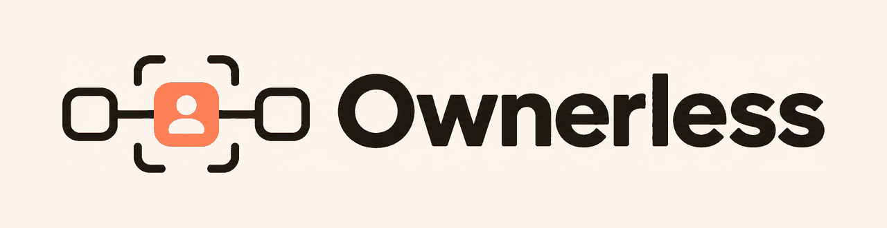
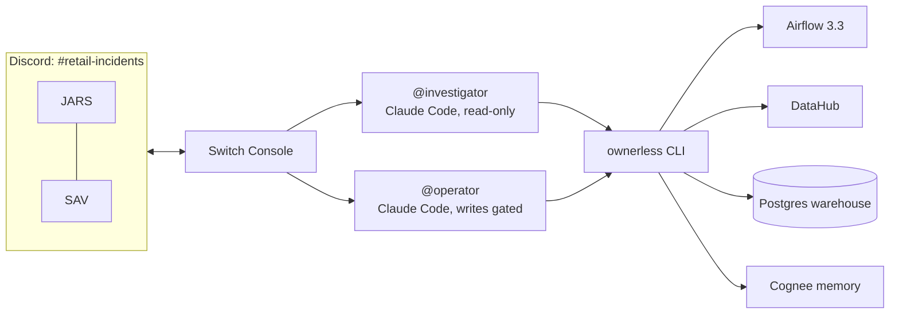

<p align="center"></p>

# Ownerless

**The incident that finds its own missing owner.**

A [Switch](https://github.com/sandbox-quantum/switch) room where two engineers and two Claude Code
agents fix a broken data pipeline together. The agents investigate across Apache Airflow, DataHub,
Postgres and Cognee, and find that the table that broke it has no owner. A person takes ownership
in the chat, and every fix needs two people: one approves in the thread, the other allows each
command through Switch's permission prompts.

Built for the [Flip the Switch Hackathon 2026](https://www.wemakedevs.org/hackathons/switch),
Best Business Workflow track.

> Website: [savani-codes.github.io/ownerless](https://savani-codes.github.io/ownerless/) · Demo video: *coming with the submission*

## The problem

At 02:00 the nightly revenue pipeline fails. The on-call engineer opens Airflow, sees
`validate_orders` failed with "3 invalid order rows", checks the warehouse, opens DataHub to find
who owns the table at fault, and finds nobody. Then the Slack hunt starts: "who owns
raw.products?" Fixing it means changing a catalog, a warehouse and a scheduler, and nobody wants
an AI doing that alone.

Ownerless turns that hour into one chat thread:

| Who | Does |
| --- | --- |
| **JARS** (on-call engineer) | Posts one message: `daily_revenue didn't refresh last night, what happened? @investigator` |
| **@investigator** (read-only agent) | Reads the failed run, the error log, the DAG, the warehouse, DataHub and lineage. Posts a report with links, finds that `raw.products` has **no owner**, suggests Data Platform, and hands a numbered fix to `@operator` |
| **SAV** (Data Platform lead) | Posts one message: "Data Platform owns products, I approve a, b and c" (**key one**) |
| **@operator** (gated agent) | Runs each step: assign the owner in DataHub, restore the products, rerun the pipeline. Each raises a Switch permission prompt that JARS allows (**key two**), then it checks the result |
| **@operator** | Verifies the revenue table and writes an incident log as a room document |

Two humans, two messages and three clicks. The dataset ends up with an owner, so the next
incident starts with a name.

## How Switch is used

Switch is the whole interface. There is no web app; the room is the product.

| Switch feature | What it does here |
| --- | --- |
| **Room template** ([`switch/ownerless.template.yaml`](switch/ownerless.template.yaml)) | One form creates both agents, the `#retail-incidents` room, its rules, a group directory and a kickoff |
| **Two agents in one room** | `@investigator` and `@operator` run as separate Claude Code sessions, each in its own folder with its own `CLAUDE.md` and permission settings |
| **@mentions** | People start the agents, and the investigator hands the plan to the operator by mentioning it |
| **Threads** | One incident, one thread: the report, the approval, each change and the verification |
| **Permission prompts** (Allow / Decline) | Every write is left out of the operator's allowlist, so each one stops for a person. CI fails if a write ever slips into an allowlist |
| **Room instructions** | The workflow and the two-key rule, read by every agent that joins |
| **Room documents** | The group directory (DataHub group → person) going in, the incident log coming out |
| **Discord bridge** | Both of us join from our own machines; Switch connects outward, so nothing is exposed |

## Architecture



The agents have one tool: the [`ownerless` CLI](tools/), which wraps the four systems and prints
JSON with a link for every entity. Reads are allowlisted. Writes are not, so Claude Code asks
Switch, and Switch asks a person in the room. More in [docs/architecture.md](docs/architecture.md).

## Run it

You need Windows with Git Bash (or macOS / Linux), Docker Desktop with about 8 GB of memory,
[uv](https://docs.astral.sh/uv/), the [DataHub CLI](https://docs.datahub.com/docs/quickstart)
(`uv tool install acryl-datahub`), and
[Switch Console](https://github.com/sandbox-quantum/switch/releases/latest) **0.40.1 or newer**
with Claude Code (older Windows builds can't run agents on Windows).

```bash
git clone --recurse-submodules https://github.com/savani-codes/ownerless.git
cd ownerless
datahub docker quickstart       # DataHub at :8080 (API) and :9002 (UI)
scripts/setup.sh                # ownerless CLI on PATH, ownerless.toml, DataHub token
scripts/up.sh --seed            # Airflow :8088, Postgres :5433, Cognee :8765, seeded
scripts/memory-sync.sh          # optional: Cognee memory (add an LLM key to .env first)
scripts/preflight.sh            # every check should say ok
```

Then create the room: in Switch Console, **Templates > Import** `switch/ownerless.template.yaml`,
**Use template**, and pick this folder and your teammate.
[switch/README.md](switch/README.md) walks through it, including the Discord bot and a
[troubleshooting table](switch/README.md#troubleshooting) for every snag we hit.

### Run the incident

```bash
ownerless scenario reset        # clean state, raw.products has no owner
ownerless scenario break        # an upstream cleanup deletes 3 products
ownerless scenario trigger      # the nightly run fails at validate_orders
```

Then in the room: `daily_revenue didn't refresh last night, what happened? @investigator`
[scenario/README.md](scenario/README.md) explains each step and what a correct investigation finds.
`scripts/down.sh` stops the stack (`--wipe` removes its data).

If a command says `DataHub rejected the token in ownerless.toml`, DataHub's containers were
recreated and the saved token died with them. Set `token = ""` under `[datahub]` in
`ownerless.toml` and run `scripts/setup.sh` again: it makes and saves a new one.

## Repository

```
switch/      the Switch template: agents, room, rules, group directory, kickoff
agents/      each agent's CLAUDE.md and Claude Code permission settings
tools/       the ownerless CLI (Python): Airflow, DataHub, Postgres, Cognee, and the scenario
scenario/    how the demo incident is staged and reset
scripts/     setup, start, stop, memory sync and preflight (bash)
deploy/      example config files
docs/        architecture and the demo script
website/     the showcase site (Vite, React, TypeScript), deployed to GitHub Pages
stack/       the demo data stack (git submodule): Airflow, warehouse, DataHub seed, Cognee
```

Tests: `cd tools && uv run pytest` and `cd website && npm test`. CI also checks that no write
command is ever allowlisted, shellchecks the scripts and builds the website.

## What's in this repository

Built for this hackathon: the Switch template and room design, both agents' roles and permission
settings, the `ownerless` CLI with its gated write commands, the staged incident, the scripts, the
website and the two-key workflow.

The demo data platform in `stack/` (Airflow 3.3, the retail warehouse, the DataHub seed and Cognee)
is a pinned git submodule, used unchanged.

## Credits and license

Built by [JARS](https://github.com/jishanahmed-shaikh) and
[SAV](https://github.com/savani-codes). Thanks to Switch (SandboxAQ), DataHub, Apache Airflow
and Cognee.

[Apache License 2.0](LICENSE). Third-party notices are in [NOTICE](NOTICE).
