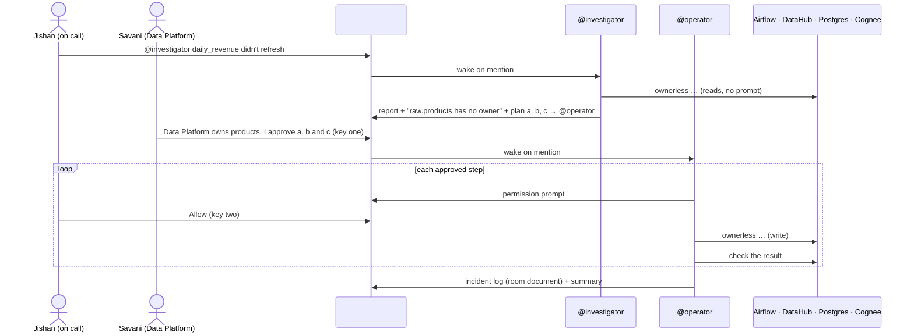

# Architecture

Ownerless has no server of its own. Switch is the interface, Claude Code is the reasoning, and a
small CLI is the only code that touches the data platform.

## Layers

| Layer | What | Where |
| --- | --- | --- |
| Chat | Discord, bridged by Switch | `switch/ownerless.template.yaml` |
| Agents | Two Claude Code sessions run by Switch Console | `agents/investigator/`, `agents/operator/` |
| Tool | `ownerless`, a Python CLI that prints JSON with links | `tools/ownerless/` |
| Platform | Airflow 3.3, Postgres, Cognee lab (Docker), DataHub (quickstart) | `vendor/cognee-data-lab`, `scripts/` |

## Why a CLI and not MCP servers

Claude Code's permission rules match Bash command prefixes, so one rule per command
(`Bash(ownerless datahub set-owner:*)`) decides exactly what needs a person. Every command is also
something a human can run and test from a terminal, and the agents can't reach anything else: the
investigator's settings deny `curl`, `psql`, `docker`, file edits and web access.

## The two keys

1. **The owner approves.** The operator's `CLAUDE.md` tells it to act only on numbered steps that a
   person (never an agent) approved in the thread.
2. **A person allows each command.** The operator's allowlist holds only reads. Each write
   (`datahub set-owner`, `warehouse restore-products`, `airflow rerun`) is left out, and the
   template sets `auto_mode: false`, so Claude Code asks for permission and Switch shows
   Allow / Decline in the room. `tools/tests/test_agent_permissions.py` builds the list of write
   commands from the CLI itself and fails CI if any of them is allowlisted.

The first key is an instruction; the second is enforced by Claude Code and Switch. Together, no
change happens without a person agreeing to it and a person allowing it.

## Configuration

Switch passes agents only a fixed set of environment variables, so nothing comes from your shell.
The CLI finds `ownerless.toml` by walking up from the agent's working directory to the repository
root. The scripts read the DataHub token from the same file, so the agents, the lab and the seed
share one copy. Both `ownerless.toml` and `.env` are gitignored.

## The staged incident

`ownerless scenario` (denied to both agents) snapshots `raw.products`, drops its foreign key (most
lakes and warehouses don't enforce one), deletes three products that orders still use, and
triggers the nightly run. `reset` restores everything and removes the owner again, so every take
starts the same way. Details in [scenario/README.md](../scenario/README.md).
